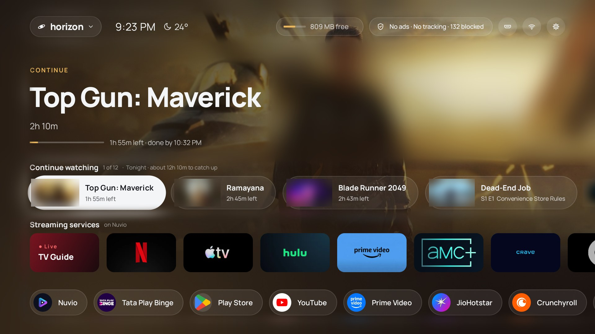
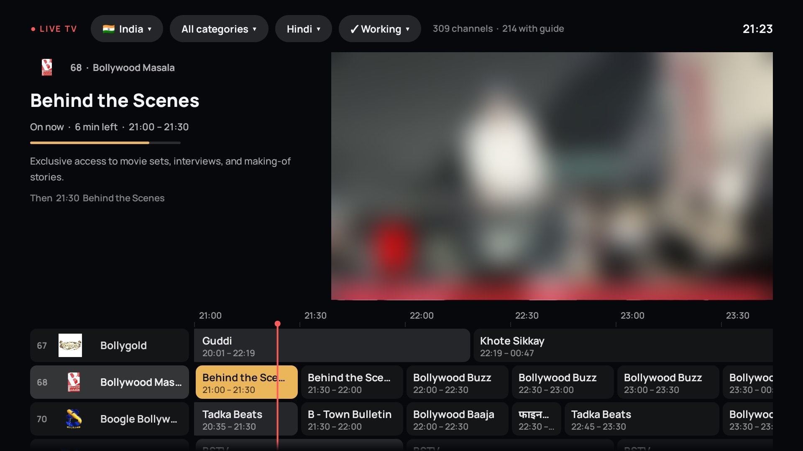

# Horizon Home Kit

An ad-free home screen for Android TV / Google TV / projectors, built around **Nuvio**, with a full **Live TV guide**. It also includes my Nuvio setup, ad blocking and speed tweaks, and a runbook so **Claude sets it all up for you**.

Built on an XGIMI Horizon S Max (Android TV 11, 1.7 GB RAM). It should work on any Android TV 8+ box or projector.

## What's inside

**Horizon Home** (`launcher/`): a home screen app, about 160 MB in memory.
- **No ads or promoted rows.** It opens on what you were watching, with a big artwork backdrop.
- **Continue watching** from Nuvio, with time left and "done by 10:32 PM".
- **Streaming services** row (Netflix, Prime, Apple TV, Hulu…). Each opens a Nuvio-powered page with the service's top 10, new and popular titles.
- **📺 Live TV guide**, TiviMate-style:
  - Big live preview at the top; filter by country, category, language and source.
  - Full screen with channel up/down and a see-through guide.
  - Favourites, and "Open in Nuvio".
  - Picks the sharpest version of each stream (up to 1080p).
- **Top bar:** free memory, with per-app memory and a "free up" button. Also ads blocked today (NextDNS), clock and weather.
- **Settings on the TV itself** (no PC needed): ad blocking, animation speed, Google TV recommendations, power button, home screen. Each change has an undo.

**Live TV addon** (`livetv-addon/`): a Nuvio/Stremio addon you host free on Cloudflare.
- About 15,500 channels in 180 countries; about 7,500 have a TV guide.
- Sources: iptv-org, a validated list, Free-TV, Samsung TV Plus, Pluto TV and Roku Channel.
- Every link is test-played every 3 hours; working and sharpest links come first.
- Rows: On now, Starting soon, Tonight. Each channel page shows its schedule.
- Also gives a playlist + guide link for TiviMate / OTT Navigator.

**Nuvio setup** (`nuvio/`): my addon list in order (no keys), and my Home layout as a template (5 collections, 58 folders).

**Windows scripts** (`windows/`): install, update, switch back, ad blocking on/off, speed tweaks, XGIMI power button. Every script backs up the original setting first and has an undo.

## Set it up with Claude (easiest)

1. Download this repo (Code → Download ZIP) and unzip it on your Windows PC.
2. Open the Claude desktop app, connect that folder, and say:
   > Set up Horizon Home Kit on my TV using SETUP-WITH-CLAUDE.md
3. Claude asks which parts you want and for the keys only you have:
   - a free TMDB key;
   - optionally a NextDNS profile;
   - a free Cloudflare account for your own Live TV server.

   It then builds and installs everything, step by step, checking the TV screen as it goes.

Your keys only go into `windows/config.bat` on your PC and into your own addon links. Nothing is uploaded anywhere else.

## Set it up yourself

1. TV: enable Developer options → **Network debugging**.
2. `windows/get-adb.bat`, then `find-projector.bat`. Copy `config.example.bat` to `config.bat` and fill it in.
3. Live TV: follow `livetv-addon/README.md` (a 5-minute Cloudflare deploy). Add the link to Nuvio and to `config.bat`.
4. Download `HorizonHome.apk` from **Releases → latest** into `windows/`, then run `install-horizon.bat`.
5. Nuvio: `nuvio/addons.md` and `nuvio/README.md`.
6. Optional: `ad-block-on.bat`, `speed-up.bat`, `xgimi-power-full-off.bat`.

**Undo:** `use-original-home.bat` puts your old home screen back. `uninstall-horizon.bat` removes the app. Every tweak has an undo script. Keep the `backup` folder the scripts create.

## Building the APK

GitHub Actions builds it on every change (Releases → latest). Locally: `launcher/build.sh` (JDK 17, Android SDK build-tools + platform 30; no Gradle).

`launcher/kit.keystore` is a public signing key so everyone's builds can update each other. Only install APKs from this repo or ones you built yourself.

## Credits

- Channel data: [iptv-org](https://github.com/iptv-org), [Free-TV/IPTV](https://github.com/Free-TV/IPTV), [AdeelWajid/iptv_validated_list](https://github.com/AdeelWajid/iptv_validated_list), Samsung TV Plus / Pluto TV / Roku listings via [i.mjh.nz](https://github.com/matthuisman/i.mjh.nz).
- Guides: [epg.pw](https://epg.pw), epgshare01.
- [Nuvio](https://nuvio.tv), [Nuvio Personalized](https://personalized.virtualpavi.com).
- Font: Manrope (SIL Open Font License).

Not affiliated with XGIMI, Google, Nuvio or any streaming service. The kit hosts no video; it only links to publicly available streams.
